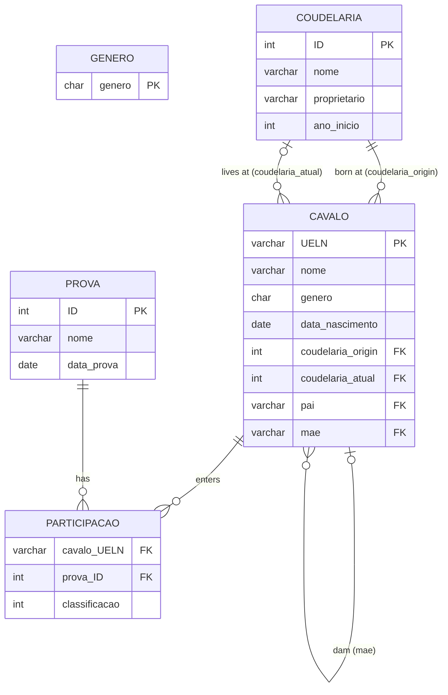

# Lusitano Stud Farm Database (MySQL)

A relational database that models a stud farm (*coudelaria*) breeding Lusitano horses. It stores each horse with its full **pedigree** (sire and dam), the studs where it was born and where it currently lives, the **competitions** it enters and the **results** it obtains, plus a set of SQL queries that answer practical breeding questions: family trees, relationships between horses, prizes won by stud, and more.
 
The model is normalized to **Third Normal Form (3NF)** and uses a self-referencing table to represent genealogy.

> Project developed for the course **Data Storage and Access**, BSc in **Electrical and Computer Engineering**, **Instituto Politécnico do Cávado e Ave (IPCA)**, **2nd year**. 

--- 

## Repository structure

```
.
├── coudelaria.sql      # schema, sample data and example queries
└── README.md
```

---

## Data model



### Tables

| Table | Description | Key |
|---|---|---|
| `genero` | Lookup table with the allowed genders (`M`, `F`) | `genero` |
| `coudelaria` | A stud farm: name, owner and year it started | `ID` (auto-increment) |
| `cavalo` | A horse: name, gender, birth date, stud of origin, current stud, and its sire and dam | `UELN` |
| `prova` | A competition: name and date | `ID` (auto-increment) |
| `participacao` | A horse's entry in a competition, with the final ranking | – |

Horses are identified by their **UELN** (*Unique Equine Life Number*), the standard identification code for equines.

### Design decisions

- **Genealogy through a self-reference:** `cavalo.pai` and `cavalo.mae` are foreign keys to `cavalo.UELN`. A horse without registered parents simply has `NULL` there, so the family tree can start at any generation, and any depth of ancestry can be reached by joining the table with itself.
- **Two stud references per horse:** `coudelaria_origin` (where the horse was born) and `coudelaria_atual` (where it is now) are kept separately, because horses change stud over their lives.
- **Many-to-many between horses and competitions:** `participacao` is an associative table. The ranking belongs to the *pair* (horse, competition), so it cannot live in either `cavalo` or `prova`.
- **Surrogate keys for studs and competitions:** names and dates are not unique, so they are not used as keys.
- **Gender in its own table:** the set of values is small and fixed, so it lives in a small lookup table (`M`, `F`). `cavalo.genero` is not yet linked to it by a foreign key (see the limitations below).
- **Insertion order matters:** because of the self-reference, parents must be inserted before their offspring.

---

## Sample data

The script loads a small data set with:

- 3 studs: *Coudelaria Lusitana*, *Haras Vale Dourado* and *Coudelaria do Norte*
- 16 horses across three generations of pedigree
- 3 competitions: *Prova Nacional de Dressage* (2023), *Campeonato Jovem Lusitano* (2024) and *Torneio Ibérico* (2024)
- 10 participations with rankings

---

## Queries

The end of the script answers seven questions. Names and codes are hard-coded in the `WHERE` clauses, so change them to query other horses or studs.

| | Question | Technique | Result on the sample data |
|---|---|---|---|
| a | Who are the grandfathers of a horse? | Four self-joins on `cavalo` | For *Brisa*, both grandfathers are *Centauro* |
| b | Which are the foals of a mare? | Filter on `mae` | Foals of *Estrela*: *Valente* and *Dama* |
| c | List all horses of a stud | `JOIN` on `coudelaria_atual` | *Coudelaria Lusitana*: *Nobre*, *Estrela* and *Relâmpago* |
| d | Which horses won 1st place, and from which stud do they come? | Join of `cavalo`, `coudelaria`, `participacao` and `prova` | *Furacão*, *Trovão* and *Brisa* (all from *Haras Vale Dourado*) |
| e | Which prizes were won by horses born in a given stud? | Four-table join, `ORDER BY` date | Every result of the horses born at *Haras Vale Dourado*, in chronological order |
| f | Are two horses related, and how? | `CASE` over several self-joins | *Estrela* and *Trovão*: "Cavalo 1 é avó de Cavalo 2" (grandmother) |
| g | What is the family tree of a horse? | Six `LEFT JOIN`s on `cavalo` | *Trovão*: parents *Valente* and *Dama*, grandparents *Nobre* and *Estrela* on both sides |

### Example: family tree (query g)

Joining `cavalo` with itself walks up the pedigree. `LEFT JOIN` is used so a horse with missing ancestors still appears in the result:

```sql
SELECT
    neto.nome AS cavalo,
    pai.nome AS pai,
    mae.nome AS mae,
    pai_do_pai.nome AS pai_do_pai,
    mae_do_pai.nome AS mae_do_pai,
    pai_da_mae.nome AS pai_da_mae,
    mae_da_mae.nome AS mae_da_mae
FROM cavalo neto
LEFT JOIN cavalo pai ON neto.pai = pai.UELN
LEFT JOIN cavalo mae ON neto.mae = mae.UELN
LEFT JOIN cavalo pai_do_pai ON pai.pai = pai_do_pai.UELN
LEFT JOIN cavalo mae_do_pai ON pai.mae = mae_do_pai.UELN
LEFT JOIN cavalo pai_da_mae ON mae.pai = pai_da_mae.UELN
LEFT JOIN cavalo mae_da_mae ON mae.mae = mae_da_mae.UELN
WHERE neto.nome = 'Trovão';
```

| cavalo | pai | mae | pai_do_pai | mae_do_pai | pai_da_mae | mae_da_mae |
|---|---|---|---|---|---|---|
| Trovão | Valente | Dama | Nobre | Estrela | Nobre | Estrela |

---

## Running the script

Requires **MySQL** (or a compatible server such as MariaDB). From the command line:

```bash
mysql -u root -p < coudelaria.sql
```

Or open `coudelaria.sql` in **MySQL Workbench** and execute it. The script creates the `coudelaria` schema, the tables and the sample data, and ends by running the seven example queries. Drop the schema first if it already exists:

```sql
DROP SCHEMA IF EXISTS coudelaria;
```

---

## Limitations and possible improvements

- The relationship query (f) only looks at direct relatives up to grandparents. Cousins, uncles and more distant relatives are reported as "no direct relation known".
- `cavalo.genero` is not enforced by a foreign key to `genero`, so any single character would be accepted.
- `participacao` has no primary key, so the same horse could be registered twice in the same competition.
- Nothing prevents a sire from being registered as female, a dam as male, or a parent being born after its offspring. `CHECK` constraints or triggers could enforce this.
- Query (g) shows two generations of ancestors. A recursive query (`WITH RECURSIVE`) would allow any depth.
- Comments in the script are in Portuguese.

---

## Author

**Ivo Azevedo**
